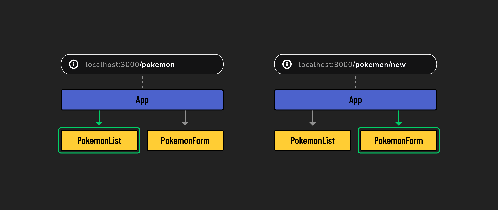

# 

**Learning objective:** By the end of this lesson, students will be able to explain what React Router is and why it is useful.

## The limitations of single-page applications

Single-page applications (SPAs) have many advantages over older, multi-page, server-side-rendered applications. However, SPAs come with certain limitations because they function as a single page, under a single URL. This restricts some of the functionality we expect from web browsers.

Here are some examples:

- With a SPA, you can't bookmark any interior pages, as the site only has one URL. You could certainly bookmark the root of the app, but you'd need to repeat a set of steps each time you wanted to go to a certain page.
- Similarly, with a SPA you can't send URL's to other people. Just like with bookmarks, if there's only one URL for the site, you'd have to include instructions on how get from the home page of the app to a specific location along with the URL itself.
- Anchor tags (`<a>`) cannot handle navigation between internal pages in a SPA. If there's only one URL for the app, you can't link between specific sub sections of an application.

Although React apps are designed as single-page applications, there is often a need to mimic the behavior of multi-page apps for features like those listed above. React itself does not provide a built-in solution for this challenge, but a widely adopted third-party library exists to address these needs.

## What is React Router?

React Router is a library for *client-side routing* in React applications. With React Router, users can experience all of the benefits of a SPA, along with the expected navigational aspects of traditional websites.

React Router allows SPAs to mimic the functionality of multi-page websites. It accomplishes this through conditional rendering. Whenever React Router detects a change in the URL, it can render corresponding components accordingly. As a result, different content and layouts can be displayed as if they were separate pages, without the need for page reloads. 

Key features of React Router include:

- **Navigation**: Enables easy navigation between different parts of your app, similar to browsing through pages on a conventional website.
- **Dynamic content loading**: Displays content based on the URL without needing to reload the entire page, keeping your app fast and responsive.
- **Route parameters**: Utilizes specific segments of the URL to display content.
- **Programmatic navigation**: Provides ways to change views programmatically, ideal for actions like redirecting a user after submitting a form.

> 📚 *Client-side routing* is a technique used in web development where navigation within an app is handled by JavaScript. Rather than making additional requests to the server every time a user navigates to a new page, information is conditionally rendered based on the URL.