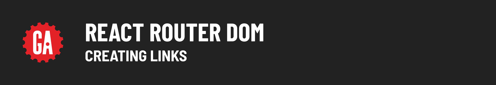

# 

**Learning objective:** By the end of this lesson, students will be able to create clickable links that will update the path of the URL in the browser

## Description

At this point, we have the ability to update the path of the URL in the browser in order to display different components in our app.  Obviously this is terrible from a user experience perspective.  How would the user know what paths to use?  Typing these paths in manually is a huge pain.  In this section, we'll create links that the user can click on, that will update the path of the URL in the browser for us.  Just like real links!

## Create a Nav Bar Structure

In the `return` statement of your `<App>` component declaration, add the follow just below `<h1>Pokemon!</h1>`:

```jsx
<nav>
	<ul>
		<li>
			Home
		</li>
		<li>
			Pokemon
		</li>
	</ul>
</nav>
```

This is currently just some static HTML at the moment, but it sets us up for creating links.

## Import Links

At the top of `src/App.jsx`, update your import statement, by adding `Link` to the list of imports we take from `react-router-dom`:

```js
import { Routes, Route, Link} from "react-router-dom"; //add Link
```

## Create Links

We've now imported the `<Link />` component that we'll use in place of the old `<a>` tag from basic HTML.  Update our nav bar by surrounding the content of our `<li>` elements with `<Link />` components like so:

```jsx
<nav>
	<ul>
		<li>
			<Link to="/">Home</Link>
		</li>
		<li>
			<Link to="/pokemon">Pokemon</Link>
		</li>
	</ul>
</nav>
```

Notice that these `<Link>` components are almost identical to `<a>` tags, but instead of an `href` attribute, we have `to` prop.

Go back to the browser and test this by clicking on the links.  Notice that clicking on a link will update the path of the URL in the browser, which in turn shows the corresponding component, as defined in our `<Routes>` component.

This feels like a multi-page app, but from the technical perspective, it's not!  It's a SPA that uses JS to mimic this user experience.